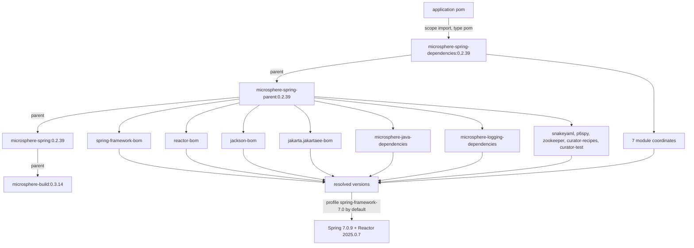

# microsphere-spring-dependencies · 0.2.x

[← User guide overview](./README.md) · [简体中文](./zh/dependencies.md) · [Developer guide](../../developer-guide/current/dependencies.md)

`microsphere-spring-dependencies` is the BOM applications import. It is a `pom`-packaging child of
`microsphere-spring-parent`, so importing it also brings the parent chain's `dependencyManagement`
(Spring, Reactor, Jackson, Jakarta EE, Microsphere Java/Logging, SnakeYAML, P6Spy, ZooKeeper,
Curator). See [parent.md](./parent.md) for the profile matrix behind those versions.

## 1. Version information

| Item | Value |
|---|---|
| Branch | `release` (0.2.x line) |
| Version line | `0.2.x` |
| `${revision}` in `pom.xml` | `0.2.40-SNAPSHOT` |
| Published version (latest tag) | `0.2.39` |
| Coordinates | `io.github.microsphere-projects:microsphere-spring-dependencies:${revision}` |
| Packaging | `pom` |
| Its own `<parent>` | `io.github.microsphere-projects:microsphere-spring-parent:${revision}` |
| Upstream build parent | `io.github.microsphere-projects:microsphere-build:0.3.17` in the working tree; the released `0.2.39` chain resolves `microsphere-build:0.3.14` |
| Java baseline | 17 |
| License | Apache License, Version 2.0 |

The released `0.2.39` BOM pom keeps its `<parent>` reference and `${...}` property placeholders
(verified in the published pom); consumers therefore also resolve
`microsphere-spring-parent:0.2.39` and `microsphere-spring:0.2.39`. Only the module coordinates in
the BOM body are flattened to a concrete version.

## 2. Artifacts managed directly by the BOM

Exactly seven entries, all `io.github.microsphere-projects`, all `${revision}`
(`0.2.39` once published):

| Artifact | Packaging | Notes |
|---|---|---|
| `microsphere-spring-context` | jar | base module |
| `microsphere-spring-guice` | jar | Guice bridge |
| `microsphere-spring-jdbc` | jar | P6Spy / DataSource support |
| `microsphere-spring-web` | jar | transport-neutral web kernel |
| `microsphere-spring-webmvc` | jar | servlet / Spring MVC adapters |
| `microsphere-spring-webflux` | jar | reactive adapters |
| `microsphere-spring-test` | jar | test support |

`microsphere-spring-parent` and `microsphere-spring-dependencies` themselves are **not** listed
(they are POMs, referenced directly), and `microsphere-spring-compatible` does not exist on this line.

## 3. Artifacts managed through the parent's `dependencyManagement`

| Entry in `microsphere-spring-parent` | Type | How it reaches your build |
|---|---|---|
| `com.fasterxml.jackson:jackson-bom` | `pom`, `import` | all `com.fasterxml.jackson.*` artifacts |
| `org.yaml:snakeyaml` | jar | direct managed version |
| `jakarta.platform:jakarta.jakartaee-bom` | `pom`, `import` | `jakarta.servlet-api`, `jakarta.websocket-api`, `jakarta.websocket-client-api`, … |
| `p6spy:p6spy` | jar | direct managed version |
| `org.apache.zookeeper:zookeeper` | jar | direct managed version |
| `org.apache.curator:curator-recipes` | jar | managed, excludes `zookeeper` |
| `org.apache.curator:curator-test` | jar | managed, excludes `zookeeper` |
| `org.springframework:spring-framework-bom` | `pom`, `import` | every `org.springframework:*` artifact used here |
| `io.projectreactor:reactor-bom` | `pom`, `import` | `reactor-core`, `reactor-test`, … |
| `io.github.microsphere-projects:microsphere-java-dependencies` | `pom`, `import` | `microsphere-java-core`, `microsphere-java-annotations`, `microsphere-jdk-tools`, `microsphere-java-test`, `microsphere-annotation-test`, `microsphere-lang-model`, `microsphere-annotation-processor` |
| `io.github.microsphere-projects:microsphere-logging-dependencies` | `pom`, `import` | `microsphere-logback`, `microsphere-logging-test`, `microsphere-java-logging`, `microsphere-logging-commons`, `microsphere-log4j`, `microsphere-log4j2` |

The last two rows' artifact lists were read from the published upstream BOM poms, not from this
repository.

## 4. Version-pinning properties

| Property key | Value | Pinned artifact(s) |
|---|---|---|
| `microsphere-java.version` | `0.3.19` | `microsphere-java-dependencies` (BOM) |
| `microsphere-logging.version` | `0.2.2` | `microsphere-logging-dependencies` (BOM) |
| `jakartaee.version` | `11.0.0` | `jakarta.jakartaee-bom` (BOM) |
| `jackson.version` | `2.22.3` | `jackson-bom` (BOM) |
| `snakeyaml.version` | `2.7` | `org.yaml:snakeyaml` |
| `p6spy.version` | `3.9.1` | `p6spy:p6spy` |
| `zookeeper.version` | `3.9.6` | `org.apache.zookeeper:zookeeper` |
| `curator.version` | `5.9.0` | `curator-recipes`, `curator-test` |
| `spring-framework.version` | `7.0.9` by default (`6.0.23` / `6.1.21` / `6.2.18` via profiles) | `spring-framework-bom` (BOM) |
| `reactor.version` | `2025.0.7` by default (`2022.0.22` / `2023.0.19` / `2024.0.17`) | `reactor-bom` (BOM) |
| `revision` (root pom) | `0.2.40-SNAPSHOT` | every module coordinate in section 2 |
| `guice.version` | `7.0.0` | **not** here — declared inside `microsphere-spring-guice/pom.xml` |

Released `0.2.39` still ships `jackson` `2.22.2`, `snakeyaml` `2.6`, `zookeeper` `3.9.5`.

## 5. Using the BOM

```xml
<project>
    <properties>
        <microsphere-spring.version>0.2.39</microsphere-spring.version>
    </properties>

    <dependencyManagement>
        <dependencies>
            <dependency>
                <groupId>io.github.microsphere-projects</groupId>
                <artifactId>microsphere-spring-dependencies</artifactId>
                <version>${microsphere-spring.version}</version>
                <type>pom</type>
                <scope>import</scope>
            </dependency>
        </dependencies>
    </dependencyManagement>

    <dependencies>
        <dependency>
            <groupId>io.github.microsphere-projects</groupId>
            <artifactId>microsphere-spring-context</artifactId>
        </dependency>
        <dependency>
            <groupId>io.github.microsphere-projects</groupId>
            <artifactId>microsphere-spring-web</artifactId>
        </dependency>
        <dependency>
            <groupId>io.github.microsphere-projects</groupId>
            <artifactId>microsphere-spring-webmvc</artifactId>
        </dependency>
        <dependency>
            <groupId>io.github.microsphere-projects</groupId>
            <artifactId>microsphere-spring-webflux</artifactId>
        </dependency>
        <dependency>
            <groupId>io.github.microsphere-projects</groupId>
            <artifactId>microsphere-spring-jdbc</artifactId>
        </dependency>
        <dependency>
            <groupId>io.github.microsphere-projects</groupId>
            <artifactId>microsphere-spring-guice</artifactId>
        </dependency>
        <dependency>
            <groupId>io.github.microsphere-projects</groupId>
            <artifactId>microsphere-spring-test</artifactId>
            <scope>test</scope>
        </dependency>
    </dependencies>
</project>
```

`<type>pom</type>` and `<scope>import</scope>` are both required; omitting either turns the entry
into a plain managed POM dependency and no versions get pulled in. Declare only the modules you use
— the modules chain into each other (`webmvc` → `web` → `context`, `jdbc` → `context`,
`guice` → `context`), so transitive resolution adds the rest.

## 6. Dependency posture

Managed does not mean transmitted. These are the real scopes in the module poms:

| You must supply | Because the module declares it | Feature that needs it |
|---|---|---|
| `org.springframework:*` (any 6.0.x–7.0.x) | `optional` in every module | the whole library |
| `com.fasterxml.jackson.core:jackson-annotations`, `jackson-databind` | `optional` (context, web, webmvc, webflux, test) | JSON property sources, endpoint JSON |
| `org.yaml:snakeyaml` | `optional` (context) | YAML property sources |
| `p6spy:p6spy` | `optional` (jdbc) | `@EnableP6DataSource` |
| `com.google.inject:guice` `7.0.0` | `optional` (guice), version not in the BOM | `@EnableGuice` |
| `jakarta.servlet:jakarta.servlet-api` | `optional` (web, test) / `provided` (webmvc) | servlet stack — container usually provides it |
| `jakarta.websocket:jakarta.websocket-api`, `jakarta.websocket-client-api` | `optional` (test) | WebSocket test helpers |
| `org.apache.zookeeper:zookeeper`, `org.apache.curator:curator-recipes`, `curator-test` | `optional` (test) | embedded ZooKeeper test support |
| `javax.annotation:javax.annotation-api`, `com.google.code.findbugs:jsr305` | `optional` (context, web) | annotation references |
| `org.xerial:sqlite-jdbc` / `com.h2database:h2` / `tomcat-embed-core` / `jsonassert` / `hamcrest` / `junit-jupiter` / `mockito-core` | `optional` (test) | embedded DB / Tomcat / assertions |

Not optional — you get them transitively: `microsphere-java-core` (from `context`, the only
mandatory external dependency of the runtime modules) and, for `microsphere-spring-test` only,
`microsphere-java-test`, `microsphere-logging-test`, `microsphere-logback`.

## 7. Not managed by this BOM

- `com.google.inject:guice` — version comes from `guice.version` inside the Guice module pom.
- `microsphere-spring-parent` / `microsphere-spring-dependencies` — POM artifacts.
- Application servers, Spring Boot, and any Spring Data artifact: this line manages Spring Framework
  and Reactor only.
- Build-plugin versions (`maven-compiler-plugin` `3.16.0`, `flatten-maven-plugin` `1.7.3`, …) live in
  `microsphere-build`, not here.

## 8. BOM import chain



## 9. Upgrade notes (0.1.x → 0.2.x)

| Topic | 0.1.x | 0.2.x |
|---|---|---|
| BOM body | same seven module entries | same seven module entries |
| Jakarta EE BOM | not imported; `tomcat-embed-core:9.0.119` pinned instead | `jakarta.jakartaee-bom:11.0.0` imported, no Tomcat pin |
| Servlet coordinates | `javax.servlet:javax.servlet-api` | `jakarta.servlet:jakarta.servlet-api` |
| Default managed Spring | `5.3.39` / Reactor `2020.0.47` | `7.0.9` / Reactor `2025.0.7` |
| Java baseline of managed set | 8 | 17 |
| `microsphere-java.version` | `0.3.19` | `0.3.19` (unchanged) |
| `compatible` module | exists in the reactor, deliberately absent from the BOM | module removed entirely |

Because the BOM coordinates are stable, moving from `0.1.39` to `0.2.39` requires no XML restructuring
beyond the version — but `javax.*` → `jakarta.*` imports and a Java 17 runtime are mandatory, and any
Spring version older than 6.0 must be dropped.

## Related documents

[context.md](./context.md) · [web.md](./web.md) · [test.md](./test.md) ·
[parent.md](./parent.md) · [1.x dependencies guide](../1.x/dependencies.md)
