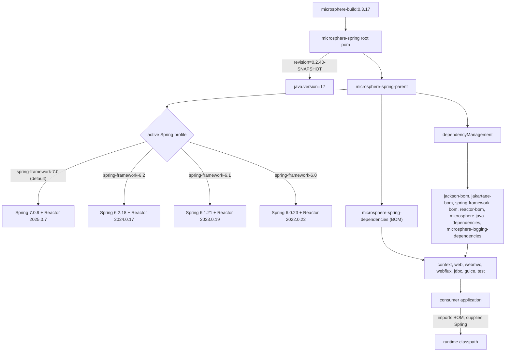

# microsphere-spring-parent · 0.2.x

[← User guide overview](./README.md) · [简体中文](./zh/parent.md) · [Developer guide](../../developer-guide/current/parent.md)

`microsphere-spring-parent` (`io.github.microsphere-projects:microsphere-spring-parent`, packaging
`pom`) is the `<parent>` of every code module in this reactor. It owns the third-party version
pins and the Spring Framework profile matrix; `microsphere-spring-dependencies` (its child) is the
BOM applications import. Build internals are in the Developer Guide, linked above.

## 1. Version information

| Item | Value |
|---|---|
| Branch | `release` (0.2.x line) |
| Version line | `0.2.x` |
| `${revision}` in `pom.xml` | `0.2.40-SNAPSHOT` |
| Published version (latest tag) | `0.2.39` |
| Reactor root artifact | `io.github.microsphere-projects:microsphere-spring:0.2.40-SNAPSHOT` |
| Upstream build parent | `io.github.microsphere-projects:microsphere-build:0.3.17` |
| Java baseline | 17 (`<java.version>17</java.version>` in the root pom; `microsphere-build` alone defaults to 8) |
| Servlet namespace | `jakarta.servlet.*` (Jakarta EE 11 BOM) |
| License | Apache License, Version 2.0 |
| Coordinates of this page's artifact | `io.github.microsphere-projects:microsphere-spring-parent:${revision}` |

> Deviation found while writing this page: the working tree pins `microsphere-build` `0.3.17`,
> while `origin/release` still pins `0.3.16`; the released `0.2.39` parent chain resolves
> `microsphere-build` `0.3.14`. Everything else in the three build poms is identical.

## 2. What the parent pins, and how inheritance changes resolved versions

Module poms declare dependencies **without versions**. A version is filled in only when Maven
builds the effective model: module → `microsphere-spring-parent` → root `microsphere-spring` →
`microsphere-build`. The `dependencyManagement` of the parent (including BOMs it imports) is what
supplies those versions; the profiles below supply `${spring-framework.version}` and
`${reactor.version}`.

| Property key | Value (0.2.x working tree) | Where it is used |
|---|---|---|
| `microsphere-java.version` | `0.3.19` | imports `microsphere-java-dependencies` (BOM) |
| `microsphere-logging.version` | `0.2.2` | imports `microsphere-logging-dependencies` (BOM) |
| `jakartaee.version` | `11.0.0` | imports `jakarta.platform:jakarta.jakartaee-bom` |
| `jackson.version` | `2.22.3` | imports `com.fasterxml.jackson:jackson-bom` |
| `snakeyaml.version` | `2.7` | manages `org.yaml:snakeyaml` directly |
| `p6spy.version` | `3.9.1` | manages `p6spy:p6spy` directly |
| `zookeeper.version` | `3.9.6` | manages `org.apache.zookeeper:zookeeper` |
| `curator.version` | `5.9.0` | manages `curator-recipes` / `curator-test` (both exclude `zookeeper`) |
| `spring-framework.version` | profile-driven, default `7.0.9` | imports `spring-framework-bom` |
| `reactor.version` | profile-driven, default `2025.0.7` | imports `io.projectreactor:reactor-bom` |

Values published with `0.2.39` are one patch step older for three entries (`jackson` `2.22.2`,
`snakeyaml` `2.6`, `zookeeper` `3.9.5`); the `2.22.3` / `2.7` / `3.9.6` pins above land with
`0.2.40`. Note also that `0.2.x` dropped the `tomcat-embed-core` pin that `0.1.x` carried in this
pom (`9.0.119`), so the Tomcat version used by `microsphere-spring-webmvc` tests is resolved through
the imported `microsphere-java-dependencies` chain and is not declared in this repository.

## 3. Supported Spring Framework range

`microsphere-spring-parent/pom.xml` declares four profiles; each pins a Spring Framework version and
the matching Project Reactor BOM:

| Profile id | `spring-framework.version` | `reactor.version` | Notes |
|---|---|---|---|
| `spring-framework-6.0` | `6.0.23` | `2022.0.22` | regression-tested in CI |
| `spring-framework-6.1` | `6.1.21` | `2023.0.19` | regression-tested in CI |
| `spring-framework-6.2` | `6.2.18` | `2024.0.17` | regression-tested in CI |
| `spring-framework-7.0` | `7.0.9` | `2025.0.7` | **`<activeByDefault>true</activeByDefault>`** |

Supported range: **Spring Framework 6.0.x – 7.0.x on Java 17+**. Any patch release inside those
lines should work — the profiles are verification anchors, not hard limits — but only the four
versions above are actually exercised.

## 4. Bringing your own Spring version

- Every Spring dependency in the code modules is `optional`, so this library never transmits a Spring
  jar; your application's own Spring version is what runs.
- `microsphere-spring-parent` and `microsphere-spring-dependencies` are published with the profile
  block and the `${spring-framework.version}` / `${reactor.version}` placeholders intact (verified in
  the released `0.2.39` poms), so the imported chain defaults to Spring `7.0.9` / Reactor `2025.0.7`.
- A profile of an imported BOM is not part of your reactor: `-P spring-framework-6.2` in your
  application build does **not** re-point this BOM, and overriding `<spring-framework.version>` in
  your own properties is not reliable either (the property is interpolated inside the BOM's model).
- The dependable mechanism is import order: declare your own `spring-framework-bom` **before** the
  Microsphere BOM — Maven keeps the first managed entry for a given `groupId:artifactId`.

```xml
<dependencyManagement>
    <dependencies>
        <dependency>
            <groupId>org.springframework</groupId>
            <artifactId>spring-framework-bom</artifactId>
            <version>6.2.18</version>
            <type>pom</type>
            <scope>import</scope>
        </dependency>
        <dependency>
            <groupId>io.github.microsphere-projects</groupId>
            <artifactId>microsphere-spring-dependencies</artifactId>
            <version>0.2.39</version>
            <type>pom</type>
            <scope>import</scope>
        </dependency>
    </dependencies>
</dependencyManagement>
```

Check the result with `mvn dependency:tree -Dincludes=org.springframework`. The first-bucket-wins
behaviour above is Maven semantics, not something asserted by these poms.

## 5. Depending on the library

Import the BOM, then add modules with no version (full list in
[dependencies.md](./dependencies.md)):

```xml
<dependencyManagement>
    <dependencies>
        <dependency>
            <groupId>io.github.microsphere-projects</groupId>
            <artifactId>microsphere-spring-dependencies</artifactId>
            <version>0.2.39</version>
            <type>pom</type>
            <scope>import</scope>
        </dependency>
    </dependencies>
</dependencyManagement>

<dependencies>
    <dependency>
        <groupId>io.github.microsphere-projects</groupId>
        <artifactId>microsphere-spring-context</artifactId>
    </dependency>
    <dependency>
        <groupId>io.github.microsphere-projects</groupId>
        <artifactId>microsphere-spring-test</artifactId>
        <scope>test</scope>
    </dependency>
</dependencies>
```

## 6. Dependency posture

| Artifact | Declared by | Scope in our poms | Supplied by the application |
|---|---|---|---|
| `microsphere-java-core` | context | compile, versioned by parent | no — the one mandatory external dependency |
| `microsphere-java-test`, `microsphere-logging-test`, `microsphere-logback` | test | compile | no (mandatory for `microsphere-spring-test` only) |
| `org.springframework:spring-context` | context, web, webflux, jdbc, guice, test | optional | yes |
| `spring-context-support`, `spring-beans`, `spring-aop` | context | optional | yes |
| `spring-context-indexer` | context, test | optional | only for annotation processing |
| `spring-web`, `spring-webmvc`, `spring-webflux`, `spring-test` | web, webmvc, webflux, test | optional | yes |
| `com.fasterxml.jackson.core:jackson-annotations`, `jackson-databind` | context, web, webmvc, webflux, test | optional | yes, if JSON features used |
| `org.yaml:snakeyaml` | context | optional | yes, for YAML property sources |
| `jakarta.servlet:jakarta.servlet-api` | web (optional), webmvc (provided), test (optional) | optional / provided | container or app |
| `jakarta.websocket:jakarta.websocket-api`, `jakarta.websocket-client-api` | test | optional | yes, for WebSocket tests |
| `p6spy:p6spy` | jdbc | optional | yes, for `@EnableP6DataSource` |
| `com.google.inject:guice` `7.0.0` | guice | optional (`guice.version` is module-local, not in the parent) | yes |
| `org.apache.zookeeper:zookeeper`, `curator-recipes`, `curator-test` | test | optional | yes, for embedded ZooKeeper tests |
| `javax.annotation:javax.annotation-api`, `com.google.code.findbugs:jsr305` | context, web | optional | yes, if referenced |
| `io.github.microsphere-projects:microsphere-annotation-processor` | all code modules | optional | build-time only |
| `sqlite-jdbc`, `h2`, `tomcat-embed-core`, `jsonassert`, `hamcrest`, `junit-jupiter`, `mockito-core` | test | optional | as needed |

## 7. Building the reactor against another Spring line

```bash
mvn clean test                                  # default profile: Spring 7.0.9 / Reactor 2025.0.7
mvn -P spring-framework-6.2 clean test          # Spring 6.2.18 / Reactor 2024.0.17
mvn -P spring-framework-6.1 clean test          # Spring 6.1.21 / Reactor 2023.0.19
mvn -P spring-framework-6.0 clean verify        # Spring 6.0.23 / Reactor 2022.0.22
mvn -Drevision=0.0.1-SNAPSHOT test              # CI-style version override
```

Activating one of the named profiles deactivates the `activeByDefault` `7.0` profile (standard Maven
behaviour). CI (`.github/workflows/maven-build.yml`) runs the four profiles against Temurin
`17`, `21`, `25` with `--activate-profiles test,coverage,<spring-framework-profile>`.

## 8. Upgrade notes (0.1.x → 0.2.x)

| Topic | 0.1.x (`release-1.x`) | 0.2.x (`release`) |
|---|---|---|
| Java baseline | 8 (inherited from `microsphere-build:0.3.14`; the branch declares no `java.version`) | 17 (declared in the root pom) |
| Servlet API | `javax.servlet:javax.servlet-api` | `jakarta.servlet:jakarta.servlet-api` via `jakarta.jakartaee-bom:11.0.0` |
| Spring lines | `4.3.30.RELEASE` → `5.3.39`, default `5.3.39` | `6.0.23` → `7.0.9`, default `7.0.9` |
| Reactor BOM | `Bismuth-SR17` … `2020.0.47` | `2022.0.22` … `2025.0.7` |
| Extra module | `microsphere-spring-compatible` (1.x only, never deployed, absent from the BOM) | does not exist |
| Test framework of main modules | JUnit 4 (`junit:junit`) in context, web, jdbc, guice | JUnit 5 (`org.junit.jupiter:junit-jupiter`) everywhere |
| build parent | `microsphere-build:0.3.14` | `microsphere-build:0.3.17` in the working tree |

Module `artifactId`s and the BOM coordinates are unchanged, so an upgrade is mostly a Spring
`javax` → `jakarta` migration plus a Java 17 toolchain. Guice is `7.0.0` on both lines; on 0.1.x
that combination needs a Java 11+ runtime even though the line targets Java 8 — a known caveat of the
older branch, not of this one.

## 9. How the versions resolve



## Related documents

[context.md](./context.md) · [web.md](./web.md) · [test.md](./test.md) ·
[dependencies.md](./dependencies.md) · [1.x parent guide](../1.x/parent.md)
