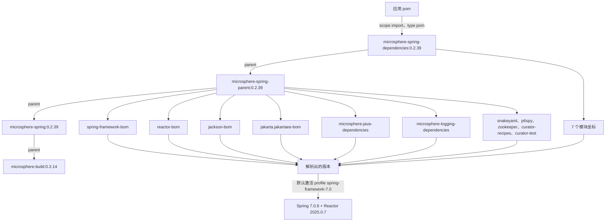

# microsphere-spring-dependencies · 0.2.x

[← 用户文档总览](./README.md) · [English](../dependencies.md) · [开发者文档](../../../developer-guide/current/zh/dependencies.md)


`microsphere-spring-dependencies` 是应用项目要导入的 BOM。它是 `microsphere-spring-parent` 的 `pom`
打包子模块，因此导入它的同时，也会带来 parent 链上的 `dependencyManagement`
（Spring、Reactor、Jackson、Jakarta EE、Microsphere Java/Logging、SnakeYAML、P6Spy、ZooKeeper、
Curator）。这些版本背后的 profile 矩阵请看 [parent.md](./parent.md)。

## 1. 版本信息

| 项目 | 值 |
|---|---|
| 分支 | `release`（0.2.x 版本线） |
| 版本线 | `0.2.x` |
| `pom.xml` 中的 `${revision}` | `0.2.40-SNAPSHOT` |
| 已发布版本（最新 tag） | `0.2.39` |
| 坐标 | `io.github.microsphere-projects:microsphere-spring-dependencies:${revision}` |
| 打包方式 | `pom` |
| 它自身的 `<parent>` | `io.github.microsphere-projects:microsphere-spring-parent:${revision}` |
| 上游构建 parent | 工作树中是 `io.github.microsphere-projects:microsphere-build:0.3.17`；已发布的 `0.2.39` 链解析到 `microsphere-build:0.3.14` |
| Java 基线 | 17 |
| 许可证 | Apache License, Version 2.0 |

已发布的 `0.2.39` BOM pom 保留了它的 `<parent>` 引用以及 `${...}` 属性占位符
（已在发布出去的 pom 中核实过）；因此消费方也会去解析
`microsphere-spring-parent:0.2.39` 和 `microsphere-spring:0.2.39`。只有 BOM 正文里的模块坐标会被
flatten 成具体的版本号。

## 2. BOM 直接管理的制品

恰好七条条目，全部属于 `io.github.microsphere-projects`，全部使用 `${revision}`
（发布后即 `0.2.39`）：

| 制品 | 打包方式 | 说明 |
|---|---|---|
| `microsphere-spring-context` | jar | 基础模块 |
| `microsphere-spring-guice` | jar | Guice 桥接 |
| `microsphere-spring-jdbc` | jar | P6Spy / DataSource 支持 |
| `microsphere-spring-web` | jar | 与传输方式无关的 web 内核 |
| `microsphere-spring-webmvc` | jar | servlet / Spring MVC 适配 |
| `microsphere-spring-webflux` | jar | 响应式适配 |
| `microsphere-spring-test` | jar | 测试支持 |

`microsphere-spring-parent` 和 `microsphere-spring-dependencies` 自身**不在**清单中
（它们是 POM，直接被引用），并且 `microsphere-spring-compatible` 在这一版本线上并不存在。

## 3. 通过 parent 的 `dependencyManagement` 管理的制品

| `microsphere-spring-parent` 中的条目 | 类型 | 它如何进入你的构建 |
|---|---|---|
| `com.fasterxml.jackson:jackson-bom` | `pom`、`import` | 所有 `com.fasterxml.jackson.*` 制品 |
| `org.yaml:snakeyaml` | jar | 直接管理的版本 |
| `jakarta.platform:jakarta.jakartaee-bom` | `pom`、`import` | `jakarta.servlet-api`、`jakarta.websocket-api`、`jakarta.websocket-client-api`，…… |
| `p6spy:p6spy` | jar | 直接管理的版本 |
| `org.apache.zookeeper:zookeeper` | jar | 直接管理的版本 |
| `org.apache.curator:curator-recipes` | jar | 受管理，排除 `zookeeper` |
| `org.apache.curator:curator-test` | jar | 受管理，排除 `zookeeper` |
| `org.springframework:spring-framework-bom` | `pom`、`import` | 此处用到的每一个 `org.springframework:*` 制品 |
| `io.projectreactor:reactor-bom` | `pom`、`import` | `reactor-core`、`reactor-test`，…… |
| `io.github.microsphere-projects:microsphere-java-dependencies` | `pom`、`import` | `microsphere-java-core`、`microsphere-java-annotations`、`microsphere-jdk-tools`、`microsphere-java-test`、`microsphere-annotation-test`、`microsphere-lang-model`、`microsphere-annotation-processor` |
| `io.github.microsphere-projects:microsphere-logging-dependencies` | `pom`、`import` | `microsphere-logback`、`microsphere-logging-test`、`microsphere-java-logging`、`microsphere-logging-commons`、`microsphere-log4j`、`microsphere-log4j2` |

最后两行的制品清单来自已发布的上游 BOM pom，而不是来自本仓库。

## 4. 锁定版本的属性

| 属性键 | 值 | 被锁定的制品 |
|---|---|---|
| `microsphere-java.version` | `0.3.19` | `microsphere-java-dependencies`（BOM） |
| `microsphere-logging.version` | `0.2.2` | `microsphere-logging-dependencies`（BOM） |
| `jakartaee.version` | `11.0.0` | `jakarta.jakartaee-bom`（BOM） |
| `jackson.version` | `2.22.3` | `jackson-bom`（BOM） |
| `snakeyaml.version` | `2.7` | `org.yaml:snakeyaml` |
| `p6spy.version` | `3.9.1` | `p6spy:p6spy` |
| `zookeeper.version` | `3.9.6` | `org.apache.zookeeper:zookeeper` |
| `curator.version` | `5.9.0` | `curator-recipes`、`curator-test` |
| `spring-framework.version` | 默认 `7.0.9`（通过 profile 可用 `6.0.23` / `6.1.21` / `6.2.18`） | `spring-framework-bom`（BOM） |
| `reactor.version` | 默认 `2025.0.7`（`2022.0.22` / `2023.0.19` / `2024.0.17`） | `reactor-bom`（BOM） |
| `revision`（根 pom） | `0.2.40-SNAPSHOT` | 第 2 节里的每一个模块坐标 |
| `guice.version` | `7.0.0` | **不在**这里——它声明在 `microsphere-spring-guice/pom.xml` 内部 |

已发布的 `0.2.39` 仍然带着 `jackson` `2.22.2`、`snakeyaml` `2.6`、`zookeeper` `3.9.5`。

## 5. 使用这个 BOM

```xml
<project>
    <properties>
        <microsphere-spring.version>0.2.39</microsphere-spring.version>
    </properties>

    <dependencyManagement>
        <dependencies>
            <dependency>
                <groupId>io.github.microsphere-projects</groupId>
                <artifactId>microsphere-spring-dependencies</artifactId>
                <version>${microsphere-spring.version}</version>
                <type>pom</type>
                <scope>import</scope>
            </dependency>
        </dependencies>
    </dependencyManagement>

    <dependencies>
        <dependency>
            <groupId>io.github.microsphere-projects</groupId>
            <artifactId>microsphere-spring-context</artifactId>
        </dependency>
        <dependency>
            <groupId>io.github.microsphere-projects</groupId>
            <artifactId>microsphere-spring-web</artifactId>
        </dependency>
        <dependency>
            <groupId>io.github.microsphere-projects</groupId>
            <artifactId>microsphere-spring-webmvc</artifactId>
        </dependency>
        <dependency>
            <groupId>io.github.microsphere-projects</groupId>
            <artifactId>microsphere-spring-webflux</artifactId>
        </dependency>
        <dependency>
            <groupId>io.github.microsphere-projects</groupId>
            <artifactId>microsphere-spring-jdbc</artifactId>
        </dependency>
        <dependency>
            <groupId>io.github.microsphere-projects</groupId>
            <artifactId>microsphere-spring-guice</artifactId>
        </dependency>
        <dependency>
            <groupId>io.github.microsphere-projects</groupId>
            <artifactId>microsphere-spring-test</artifactId>
            <scope>test</scope>
        </dependency>
    </dependencies>
</project>
```

`<type>pom</type>` 和 `<scope>import</scope>` 两者都必须写；漏掉任意一个，这条条目就会变成一个
普通的受管理 POM 依赖，什么都不会带进来。只声明你要用的模块
——这些模块彼此串联（`webmvc` → `web` → `context`、`jdbc` → `context`、
`guice` → `context`），所以传递解析会把其余的补齐。

## 6. 依赖态势

被管理不等于会被传递。下面是各模块 pom 里真实的 scope：

| 你必须自己提供 | 因为模块这样声明它 | 需要它的功能 |
|---|---|---|
| `org.springframework:*`（任意 6.0.x–7.0.x） | 每个模块中都是 `optional` | 整个库 |
| `com.fasterxml.jackson.core:jackson-annotations`、`jackson-databind` | `optional`（context、web、webmvc、webflux、test） | JSON 属性源、endpoint JSON |
| `org.yaml:snakeyaml` | `optional`（context） | YAML 属性源 |
| `p6spy:p6spy` | `optional`（jdbc） | `@EnableP6DataSource` |
| `com.google.inject:guice` `7.0.0` | `optional`（guice），版本不在 BOM 里 | `@EnableGuice` |
| `jakarta.servlet:jakarta.servlet-api` | `optional`（web、test）/ `provided`（webmvc） | servlet 技术栈——容器通常会提供 |
| `jakarta.websocket:jakarta.websocket-api`、`jakarta.websocket-client-api` | `optional`（test） | WebSocket 测试辅助类 |
| `org.apache.zookeeper:zookeeper`、`org.apache.curator:curator-recipes`、`curator-test` | `optional`（test） | 内嵌 ZooKeeper 测试支持 |
| `javax.annotation:javax.annotation-api`、`com.google.code.findbugs:jsr305` | `optional`（context、web） | 注解引用 |
| `org.xerial:sqlite-jdbc` / `com.h2database:h2` / `tomcat-embed-core` / `jsonassert` / `hamcrest` / `junit-jupiter` / `mockito-core` | `optional`（test） | 内嵌数据库 / Tomcat / 断言 |

并非 optional——你会传递地拿到它们：`microsphere-java-core`（来自 `context`，是运行时模块唯一
强制的外部依赖），以及仅对 `microsphere-spring-test` 才有的
`microsphere-java-test`、`microsphere-logging-test`、`microsphere-logback`。

## 7. 不由本 BOM 管理的内容

- `com.google.inject:guice`——版本来自 Guice 模块 pom 内部的 `guice.version`。
- `microsphere-spring-parent` / `microsphere-spring-dependencies`——它们是 POM 制品。
- 应用服务器、Spring Boot 以及任何 Spring Data 制品：这一版本线只管理 Spring Framework
  和 Reactor。
- 构建插件版本（`maven-compiler-plugin` `3.16.0`、`flatten-maven-plugin` `1.7.3`，……）位于
  `microsphere-build`，不在这里。

## 8. BOM 导入链



## 9. 升级说明（0.1.x → 0.2.x）

| 主题 | 0.1.x | 0.2.x |
|---|---|---|
| BOM 正文 | 同样是七条模块条目 | 同样是七条模块条目 |
| Jakarta EE BOM | 未导入；改为锁定 `tomcat-embed-core:9.0.119` | 导入 `jakarta.jakartaee-bom:11.0.0`，不再锁定 Tomcat |
| Servlet 坐标 | `javax.servlet:javax.servlet-api` | `jakarta.servlet:jakarta.servlet-api` |
| 默认受管理的 Spring | `5.3.39` / Reactor `2020.0.47` | `7.0.9` / Reactor `2025.0.7` |
| 受管集合的 Java 基线 | 8 | 17 |
| `microsphere-java.version` | `0.3.19` | `0.3.19`（未变） |
| `compatible` 模块 | 存在于 reactor 中，且刻意不放进 BOM | 模块被整体移除 |

由于 BOM 坐标保持稳定，从 `0.1.39` 迁到 `0.2.39` 除了版本号之外不需要重组 XML
——但 `javax.*` → `jakarta.*` 的导入改动和 Java 17 运行时是强制的，并且任何
低于 6.0 的 Spring 版本都必须放弃。

## 相关文档

[context.md](./context.md) · [web.md](./web.md) · [test.md](./test.md) ·
[parent.md](./parent.md) · [1.x dependencies 文档](../../1.x/zh/dependencies.md)
