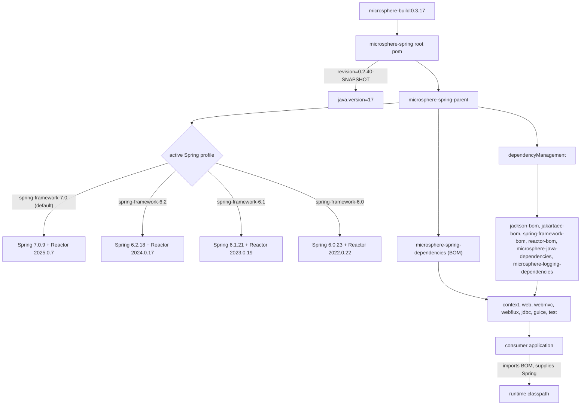

# microsphere-spring-parent · 0.2.x

[← 用户文档总览](./README.md) · [English](../parent.md) · [开发者文档](../../../developer-guide/current/zh/parent.md)

`microsphere-spring-parent`（`io.github.microsphere-projects:microsphere-spring-parent`，打包类型
`pom`）是本 reactor 中所有代码模块的 `<parent>`。它负责第三方版本锁定与 Spring Framework profile
矩阵；它的子模块 `microsphere-spring-dependencies` 才是应用导入的 BOM。构建内部机制见上文链接的
开发者文档。

## 1. 版本信息

| 项目 | 值 |
|---|---|
| 分支 | `release`（0.2.x 线） |
| 版本线 | `0.2.x` |
| `pom.xml` 中的 `${revision}` | `0.2.40-SNAPSHOT` |
| 已发布版本（最新 tag） | `0.2.39` |
| reactor 根坐标 | `io.github.microsphere-projects:microsphere-spring:0.2.40-SNAPSHOT` |
| 上游构建父 POM | `io.github.microsphere-projects:microsphere-build:0.3.17` |
| Java 基线 | 17（根 POM 中 `<java.version>17</java.version>`；`microsphere-build` 自身默认是 8） |
| Servlet 命名空间 | `jakarta.servlet.*`（Jakarta EE 11 BOM） |
| 许可证 | Apache License, Version 2.0 |
| 本页工件坐标 | `io.github.microsphere-projects:microsphere-spring-parent:${revision}` |

> 撰写本页时发现的偏差：工作区中的根 POM 锁定 `microsphere-build` `0.3.17`，而 `origin/release`
> 仍为 `0.3.16`；已发布的 `0.2.39` 父链解析到 `microsphere-build` `0.3.14`。三个构建 POM 的其余
> 内容完全一致。

## 2. 父 POM 锁定了什么，继承如何改变解析出的版本

各模块 POM 声明依赖时**不写版本**。只有 Maven 构建 effective model 时才会填充版本：模块 →
`microsphere-spring-parent` → 根 `microsphere-spring` → `microsphere-build`。提供这些版本的是父 POM 的
`dependencyManagement`（含它导入的各个 BOM）；下表的 `${spring-framework.version}` 与
`${reactor.version}` 则由 profile 提供。

| 属性键 | 值（0.2.x 工作区） | 使用位置 |
|---|---|---|
| `microsphere-java.version` | `0.3.19` | 导入 `microsphere-java-dependencies`（BOM） |
| `microsphere-logging.version` | `0.2.2` | 导入 `microsphere-logging-dependencies`（BOM） |
| `jakartaee.version` | `11.0.0` | 导入 `jakarta.platform:jakarta.jakartaee-bom` |
| `jackson.version` | `2.22.3` | 导入 `com.fasterxml.jackson:jackson-bom` |
| `snakeyaml.version` | `2.7` | 直接管理 `org.yaml:snakeyaml` |
| `p6spy.version` | `3.9.1` | 直接管理 `p6spy:p6spy` |
| `zookeeper.version` | `3.9.6` | 管理 `org.apache.zookeeper:zookeeper` |
| `curator.version` | `5.9.0` | 管理 `curator-recipes` / `curator-test`（两者都排除 `zookeeper`） |
| `spring-framework.version` | 由 profile 决定，默认 `7.0.9` | 导入 `spring-framework-bom` |
| `reactor.version` | 由 profile 决定，默认 `2025.0.7` | 导入 `io.projectreactor:reactor-bom` |

随 `0.2.39` 发布的值在其中三项上低一个补丁号（`jackson` `2.22.2`、`snakeyaml` `2.6`、
`zookeeper` `3.9.5`）；上文的 `2.22.3` / `2.7` / `3.9.6` 要到 `0.2.40` 才生效。另外 `0.2.x` 移除了
本 POM 中 `0.1.x` 保留的 `tomcat-embed-core` 锁定（`9.0.119`），因此 `microsphere-spring-webmvc`
测试使用的 Tomcat 版本经由导入的 `microsphere-java-dependencies` 链解析，本仓库中并无声明。

## 3. 受支持的 Spring Framework 范围

`microsphere-spring-parent/pom.xml` 声明了四个 profile，各自锁定一个 Spring Framework 版本与匹配的
Project Reactor BOM：

| Profile id | `spring-framework.version` | `reactor.version` | 说明 |
|---|---|---|---|
| `spring-framework-6.0` | `6.0.23` | `2022.0.22` | CI 回归验证 |
| `spring-framework-6.1` | `6.1.21` | `2023.0.19` | CI 回归验证 |
| `spring-framework-6.2` | `6.2.18` | `2024.0.17` | CI 回归验证 |
| `spring-framework-7.0` | `7.0.9` | `2025.0.7` | **`<activeByDefault>true</activeByDefault>`** |

支持范围：**Spring Framework 6.0.x – 7.0.x，Java 17+**。这些线内的任意补丁版本理论上都可用——
profile 是验证锚点而非硬性上限——但实际被执行的只有上表四个版本。

## 4. 应用自带 Spring 版本时

- 代码模块中每个 Spring 依赖都是 `optional`，本库不会传递引入任何 Spring jar，运行时用的是应用自己的
  Spring 版本。
- `microsphere-spring-parent` 与 `microsphere-spring-dependencies` 发布时保留了 profile 块以及
  `${spring-framework.version}` / `${reactor.version}` 占位符（在已发布的 `0.2.39` POM 中已核实），
  因此导入链默认解析到 Spring `7.0.9` / Reactor `2025.0.7`。
- 被导入 BOM 的 profile 不属于你的 reactor：在应用构建里执行 `-P spring-framework-6.2` **不会**改变本
  BOM 的解析结果；在自己 properties 里覆盖 `<spring-framework.version>` 也不可靠（该属性在 BOM 自身
  模型内插值）。
- 可靠的机制是导入顺序：在你自己的 `spring-framework-bom` **先于** Microsphere BOM 声明——Maven 对同一
  `groupId:artifactId` 只保留第一个受管条目。

```xml
<dependencyManagement>
    <dependencies>
        <dependency>
            <groupId>org.springframework</groupId>
            <artifactId>spring-framework-bom</artifactId>
            <version>6.2.18</version>
            <type>pom</type>
            <scope>import</scope>
        </dependency>
        <dependency>
            <groupId>io.github.microsphere-projects</groupId>
            <artifactId>microsphere-spring-dependencies</artifactId>
            <version>0.2.39</version>
            <type>pom</type>
            <scope>import</scope>
        </dependency>
    </dependencies>
</dependencyManagement>
```

用 `mvn dependency:tree -Dincludes=org.springframework` 校验结果。上述“先声明者胜出”是 Maven 语义，
并非这些 POM 所做的声明。

## 5. 如何依赖本库

先导入 BOM，再按需引入模块（完整清单见
[dependencies.md](./dependencies.md)）：

```xml
<dependencyManagement>
    <dependencies>
        <dependency>
            <groupId>io.github.microsphere-projects</groupId>
            <artifactId>microsphere-spring-dependencies</artifactId>
            <version>0.2.39</version>
            <type>pom</type>
            <scope>import</scope>
        </dependency>
    </dependencies>
</dependencyManagement>

<dependencies>
    <dependency>
        <groupId>io.github.microsphere-projects</groupId>
        <artifactId>microsphere-spring-context</artifactId>
    </dependency>
    <dependency>
        <groupId>io.github.microsphere-projects</groupId>
        <artifactId>microsphere-spring-test</artifactId>
        <scope>test</scope>
    </dependency>
</dependencies>
```

## 6. 依赖姿态

| 工件 | 声明模块 | 本库 POM 中的 scope | 需由应用提供 |
|---|---|---|---|
| `microsphere-java-core` | context | compile，版本由父 POM 管理 | 否——唯一必需的外部依赖 |
| `microsphere-java-test`、`microsphere-logging-test`、`microsphere-logback` | test | compile | 否（仅 `microsphere-spring-test` 必需） |
| `org.springframework:spring-context` | context, web, webflux, jdbc, guice, test | optional | 是 |
| `spring-context-support`、`spring-beans`、`spring-aop` | context | optional | 是 |
| `spring-context-indexer` | context, test | optional | 仅注解处理阶段 |
| `spring-web`、`spring-webmvc`、`spring-webflux`、`spring-test` | web, webmvc, webflux, test | optional | 是 |
| `com.fasterxml.jackson.core:jackson-annotations`、`jackson-databind` | context, web, webmvc, webflux, test | optional | 使用 JSON 特性时是 |
| `org.yaml:snakeyaml` | context | optional | YAML 属性源时是 |
| `jakarta.servlet:jakarta.servlet-api` | web（optional）、webmvc（provided）、test（optional） | optional / provided | 容器或应用 |
| `jakarta.websocket:jakarta.websocket-api`、`jakarta.websocket-client-api` | test | optional | WebSocket 测试时是 |
| `p6spy:p6spy` | jdbc | optional | 使用 `@EnableP6DataSource` 时是 |
| `com.google.inject:guice` `7.0.0` | guice | optional（`guice.version` 是模块内属性，不在父 POM） | 是 |
| `org.apache.zookeeper:zookeeper`、`curator-recipes`、`curator-test` | test | optional | 内嵌 ZooKeeper 测试时是 |
| `javax.annotation:javax.annotation-api`、`com.google.code.findbugs:jsr305` | context, web | optional | 被引用时是 |
| `io.github.microsphere-projects:microsphere-annotation-processor` | 所有代码模块 | optional | 仅构建期 |
| `sqlite-jdbc`、`h2`、`tomcat-embed-core`、`jsonassert`、`hamcrest`、`junit-jupiter`、`mockito-core` | test | optional | 按需 |

## 7. 用其他 Spring 线构建本 reactor

```bash
mvn clean test                                  # 默认 profile：Spring 7.0.9 / Reactor 2025.0.7
mvn -P spring-framework-6.2 clean test          # Spring 6.2.18 / Reactor 2024.0.17
mvn -P spring-framework-6.1 clean test          # Spring 6.1.21 / Reactor 2023.0.19
mvn -P spring-framework-6.0 clean verify        # Spring 6.0.23 / Reactor 2022.0.22
mvn -Drevision=0.0.1-SNAPSHOT test              # CI 风格的版本覆盖
```

显式激活其中任一 profile 会使 `activeByDefault` 的 `7.0` profile 失效（标准 Maven 行为）。CI
（`.github/workflows/maven-build.yml`）在 Temurin `17`、`21`、`25` 上跑四个 profile，参数为
`--activate-profiles test,coverage,<spring-framework-profile>`。

## 8. 升级说明（0.1.x → 0.2.x）

| 主题 | 0.1.x（`release-1.x`） | 0.2.x（`release`） |
|---|---|---|
| Java 基线 | 8（继承自 `microsphere-build:0.3.14`，该分支未声明 `java.version`） | 17（根 POM 显式声明） |
| Servlet API | `javax.servlet:javax.servlet-api` | `jakarta.servlet:jakarta.servlet-api`，经 `jakarta.jakartaee-bom:11.0.0` |
| Spring 线 | `4.3.30.RELEASE` → `5.3.39`，默认 `5.3.39` | `6.0.23` → `7.0.9`，默认 `7.0.9` |
| Reactor BOM | `Bismuth-SR17` … `2020.0.47` | `2022.0.22` … `2025.0.7` |
| 额外模块 | `microsphere-spring-compatible`（仅 1.x，从不 deploy，也不在 BOM 中） | 不存在 |
| 主模块测试框架 | context、web、jdbc、guice 用 JUnit 4（`junit:junit`） | 全部使用 JUnit 5（`org.junit.jupiter:junit-jupiter`） |
| 构建父 POM | `microsphere-build:0.3.14` | 工作区为 `microsphere-build:0.3.17` |

模块 `artifactId` 与 BOM 坐标未变，因此升级主要是 Spring 的 `javax` → `jakarta` 迁移加上 Java 17
工具链。两条线的 Guice 都是 `7.0.0`；在 0.1.x 上该组合需要 Java 11+ 运行时，尽管该分支以 Java 8
为目标——这是旧分支的已知限制，与本分支无关。

## 9. 版本如何解析



## 相关文档

[context.md](./context.md) · [web.md](./web.md) · [test.md](./test.md) ·
[dependencies.md](./dependencies.md) · [1.x 父 POM 文档](../../1.x/zh/parent.md)
